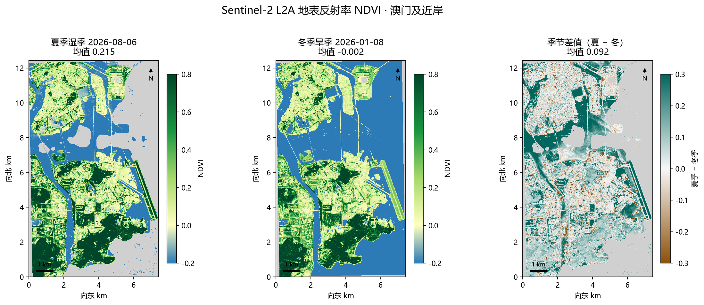
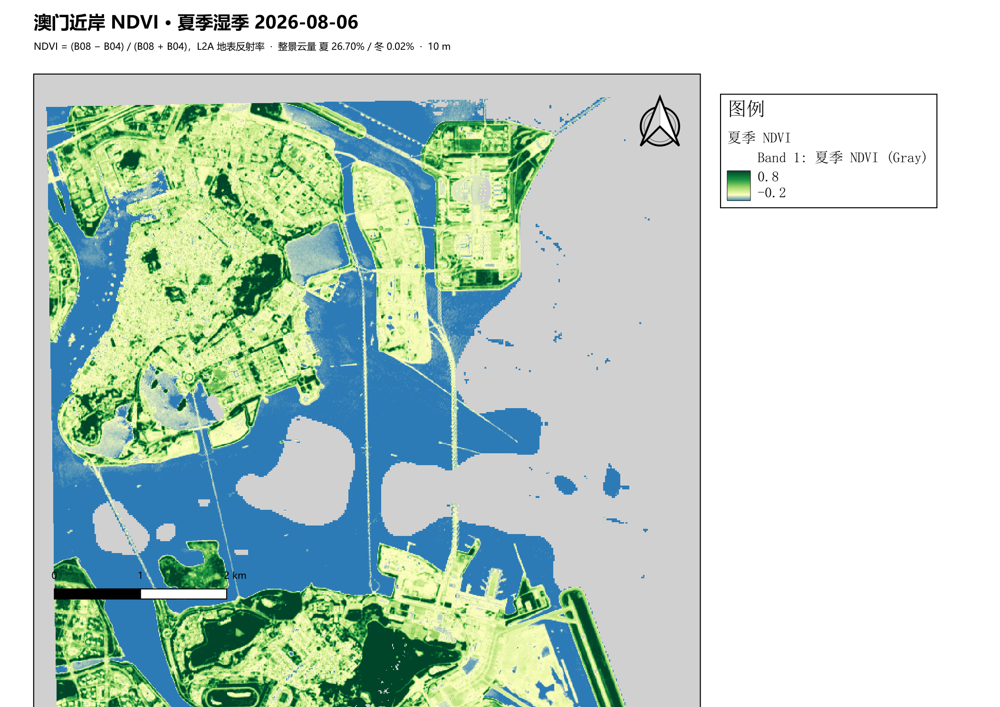
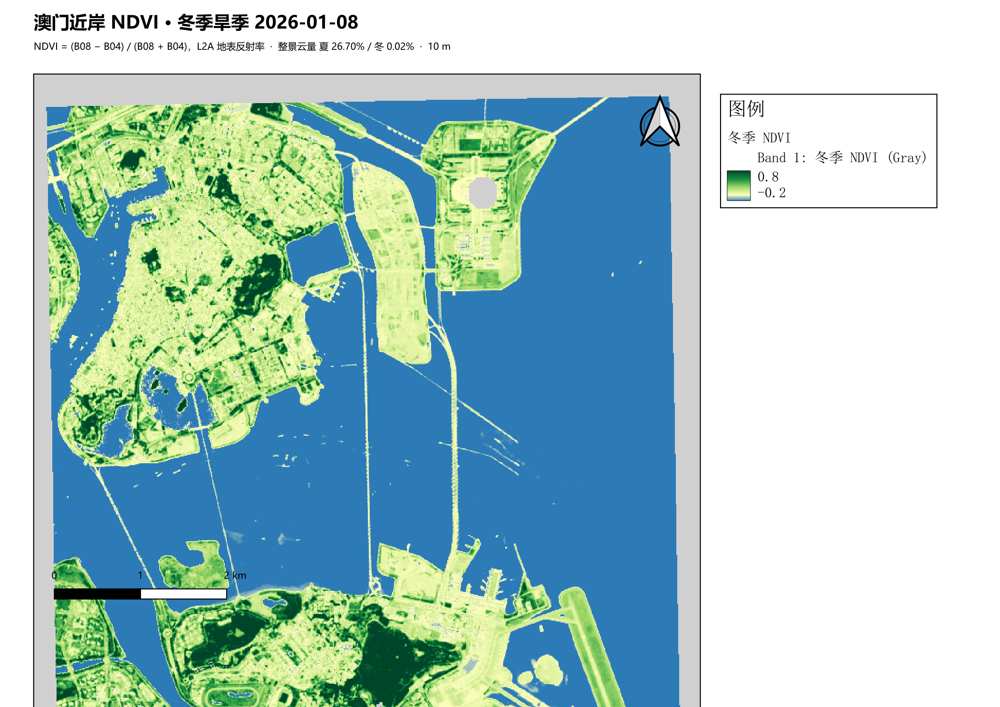
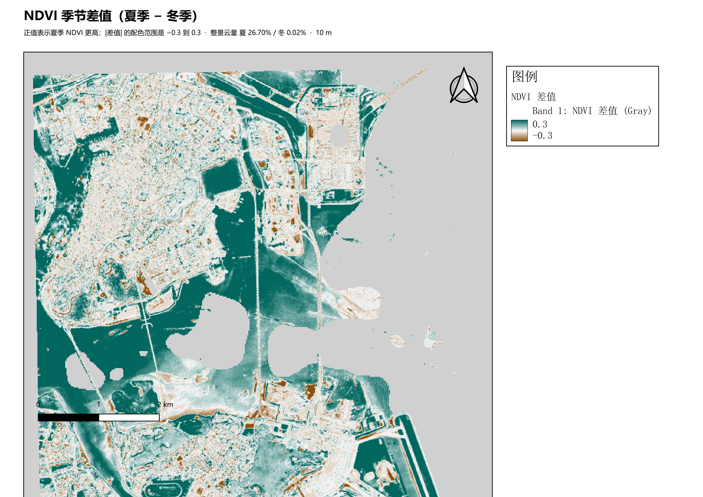
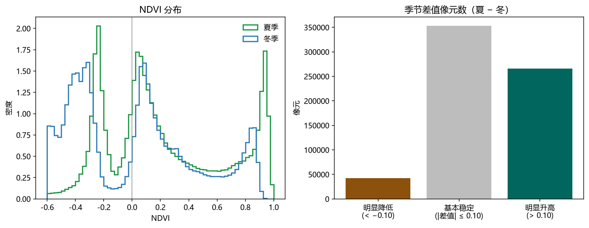

# Sentinel-2 NDVI 计算与季节对比

用两景 Sentinel-2 L2A，在澳门及近岸矩形研究区计算 NDVI，并比较 2026 年 1 月 8 日（冬季旱季）和 2026 年 8 月 6 日（夏季湿季）。这是遥感入门练习：跑通大气校正产品、云掩膜、裁剪、波段运算和 QGIS 制图，不把它说成业务监测系统。



上图由 Python 按固定拉伸出图（NDVI 为 −0.2 到 0.8，差值是夏季减冬季，−0.3 到 0.3）。带指北针、比例尺和图例的单张排版在 `outputs/maps/`，由本机 QGIS 3.44.14 导出。

| 夏季湿季 2026-08-06 | 冬季旱季 2026-01-08 | 季节差值 |
| --- | --- | --- |
|  |  |  |

## 数据从哪来

两景都来自 Copernicus Sentinel-2 L2A Collection-1，经 [Element84 Earth Search](https://earth-search.aws.element84.com/v1) 的公开 COG 读取，没有整景下载。

| 角色 | 产品 | 成像时间 (UTC) | 卫星 | 分幅 | 处理基线 | 整景云量 |
| --- | --- | --- | --- | --- | --- | --- |
| 冬季旱季 | `S2C_T49QGE_20260108T030118_L2A` | 2026-01-08 03:11:53 | Sentinel-2C | 49QGE | 05.11 | 0.02% |
| 夏季湿季 | `S2C_T49QGE_20260806T030726_L2A` | 2026-08-06 03:11:49 | Sentinel-2C | 49QGE | 05.12 | 26.70% |

研究区是 WGS84 矩形 `113.528°E–113.598°E`，`22.106°N–22.217°N`（`data/raw/aoi.geojson`），盖住澳门半岛、氹仔、路凼、路环和紧邻水域。西缘可能带入横琴极小一部分。输出投影为 EPSG:32649，像元 10 m，与 B04/B08 的原生分辨率一致。

整块读取约 1.5 MB 的 10 m 压缩瓦片时，HTTP 响应会被截断（`TIFFFillTile: got N bytes, expected M`）。脚本改为按不超过 1 MB 的 Range 分段下载，在本地解开 Deflate 并还原水平差分，得到原生 10 m 像元。SCL 本身是 20 m，用最近邻对齐到 10 m 格网，所以云掩膜边界仍按 20 m 台阶变化。公式只用 B04 和 B08。

地表反射率按 GeoTIFF 的 scale/offset 换算：`反射率 = DN × 0.0001 − 0.1`，也就是 `(DN − 1000) / 10000`。NDVI 对两波段共同的乘数不敏感，对这个加性偏移敏感，所以先换算再做比值。

L2A 是已经做过大气校正的地表反射率，几何校正也由产品方完成。本项目没有自己跑 Sen2Cor。云、云影、卷云、饱和和无数据用 SCL 去掉（去掉类别 0、1、3、8、9、10、11），保留暗像元、植被、非植被、水体和未分类。

2026 年 6–8 月，分幅 49QGE 上整景云量最低的是 8 月 8 日的 S2A（23.15%），没有一景低于 10%。8 月 6 日整景云量 26.70%，但与冬季同为 Sentinel-2C。研究区内 SCL 晴空像元：冬季 99.89%，夏季 74.76%（最终 NDVI 有效像元占研究区 74.67% 和 99.88%）。夏季差值图上的灰色斑块是被掩掉的云。

数据出处：Contains modified Copernicus Sentinel data 2026。代码使用 MIT 许可证，卫星数据不随 MIT 再授权。

## 怎么复现

需要 Python 3.12+ 和能访问 Earth Search 的网络。QGIS 步骤使用本机 `E:\QGIS`（QGIS 3.44.14，桌面程序是 `E:\QGIS\bin\qgis-ltr-bin.exe`）。

```powershell
python -m venv venv
.\venv\Scripts\python.exe -m pip install -r requirements.txt
.\venv\Scripts\python.exe -u run_pipeline.py
```

这一条命令会：下载研究区窗口 → 用 rasterio 计算 NDVI 和差值 → 调用 `E:\QGIS\bin\python-qgis-ltr.bat` 做裁剪、栅格计算和布局导出。只要本地 GeoTIFF 还在，可以加 `--skip-fetch`。没有 QGIS 时加 `--skip-qgis`，稍后再运行：

```powershell
powershell -ExecutionPolicy Bypass -File qgis\run_qgis.ps1
```

在 QGIS 界面里做同一件事：

1. 加入 `data/raw/s2_summer_boa.tif`、`s2_winter_boa.tif` 和 `data/raw/aoi.geojson`。波段顺序是 B02、B03、B04、B08。
2. 处理工具箱运行 `gdal:cliprasterbymasklayer`（按掩膜图层裁剪栅格），掩膜用研究区，裁到掩膜范围，保留分辨率，无数据 −9999。
3. 处理工具箱运行 `gdal:rastercalculator`。A 取第 3 波段（红），B 取第 4 波段（近红外），公式 `(B-A)/(A+B)`。反射率小于 0 的像元（含无数据 −9999）不要进入比值。
4. 冬季 NDVI 作为 A、夏季 NDVI 作为 B，再算 `B-A`。
5. 单波段伪彩色：NDVI 从 −0.2（蓝）到 0.8（深绿）；差值从 −0.3（棕）到 0.3（青绿），0 为浅色。
6. 布局里加图例、比例尺（千米）和指北针，导出 PNG。

`outputs/backend_compare.json` 记录了这次 Python 与 QGIS 的对照：三幅栅格重叠像元的 RMSE 都是 0.0，均值差为 0（夏季均值都是 0.2147，冬季都是 −0.0024，差值都是 0.0925）。

没有网络时，只能检查公式能不能跑，不能当成澳门的结果：

```powershell
.\venv\Scripts\python.exe make_test_scene.py
.\venv\Scripts\python.exe compute_ndvi.py --demo
```

合成栅格写到 `outputs/demo/`。它的坐标是占位用的，不是澳门。

原始窗口在 `data/raw/*.tif`，已写入 `.gitignore`。场景编号、云量和换算系数在 `data/raw/scene_catalog.json`。

## 结果与结论

NDVI = (B08 − B04) / (B08 + B04)。叶片在红光吸收强、在近红外反射强，比值把这种反差拉到接近 1；水体两个波段都低，或红光相对更高，比值落到 0 附近或负值。分母用来消掉两波段一起变亮或变暗的那一部分。

差值 = 夏季 NDVI − 冬季 NDVI。只在两期都有效的像元上计算。下面的数字来自 `outputs/stats.json`（10 m 像元，面积 = 像元数 × 100 m²）。

研究区多边形内有 888261 个 10 m 像元，约 88.83 km²。

| 指标 | 夏季 2026-08-06 | 冬季 2026-01-08 | 差值（夏−冬） |
| --- | ---: | ---: | ---: |
| 有效像元 | 662653（74.60%） | 887044（99.86%） | 661701 |
| 面积 | 66.27 km² | 88.70 km² | 66.17 km² |
| 均值 | 0.215 | −0.002 | 0.093 |
| 中位数 | 0.117 | 0.028 | 0.068 |
| 5%–95% | −0.325 – 0.938 | −0.582 – 0.829 | −0.118 – 0.392 |
| 最小值 / 最大值 | −0.997 / 1.000 | −0.992 / 0.982 | −1.116 / 1.687 |

NDVI 都落在 −1 到 1。差值可以超出这个区间：夏季接近 1、冬季为负时，差可以大于 1。这次差值的 95% 分位是 0.392，图上 −0.3 到 0.3 的拉伸会把最绿的那一截尾部画满。

按常用目视区间统计（没有地面样本，不能当成分类精度）：

| 区间 | 夏季 | 冬季 |
| --- | ---: | ---: |
| < 0（水体或强吸收） | 32.33% | 47.95% |
| 0–0.2（建成区、裸地、稀疏表面） | 26.04% | 22.28% |
| 0.2–0.5 | 14.56% | 13.77% |
| ≥ 0.5（较密植被） | 27.07% | 15.99% |

用当日 SCL 把像元分开之后，数值和地物对得上：

| SCL | 夏季 NDVI 均值 | 冬季 NDVI 均值 |
| --- | ---: | ---: |
| 水体（6） | −0.188 | −0.342 |
| 非植被（5） | 0.135 | 0.196 |
| 植被（4） | 0.781 | 0.749 |

水体为负，植被明显高于 0.7。冬季被标成植被的像元仍然有 0.75，符合亚热带常绿植被，不是温带那种冬天掉到 0 附近。被夏季 SCL 标成植被的像元，相对同一位置的冬季 NDVI 平均高 0.142（中位数 0.106）。被夏季 SCL 标成水体的像元，差值平均也有 0.143（中位数 0.150）：冬季水体更负，所以海面上也会出现正差值。读差值图时要同时看绝对 NDVI，不能把所有青绿色都解释成植被增加。

两期都有效的像元里，差值 > 0.10 的有 265972 个（26.60 km²，占重叠像元 40.2%），差值 < −0.10 的有 42520 个（4.25 km²，6.4%），其余 353209 个（35.32 km²，53.4%）落在 ±0.10 以内。±0.10 只是本练习用来分开“明显升降”和“基本稳定”的阈值。

三个分区是手绘矩形（`data/raw/zones.geojson`），用来对比半岛、路凼和路环，不是官方境界。分区差值只用两期都有效的像元：

| 分区 | 夏季均值 | 冬季均值 | 差值均值 |
| --- | ---: | ---: | ---: |
| 澳门半岛 | 0.092 | −0.004 | 0.086 |
| 氹仔—路凼 | 0.130 | −0.073 | 0.081 |
| 路环 | 0.397 | 0.063 | 0.089 |

路环的绝对 NDVI 最高，半岛最低，和丘陵植被、建成区的分布一致。三个分区的平均差值都在 0.08 左右。夏季各分区的有效像元比冬季少，云若更多盖在水面上，只看夏季均值会偏向陆地；比较季节时以“差值”这一列为准。

分布图：



冬季在大约 −0.3 有一个水体峰，夏季这个峰变弱，同时 0.8 以上的植被峰更高。这和上表的类别比例一致。

## 局限

- 只有两个日期，分不开季节物候和其间的施工、填海或绿化。
- 反射率波段是 10 m 原生格网。SCL 仍是 20 m，最近邻到 10 m 后，云掩膜边缘呈 20 m 台阶。
- 夏季整景云量 26.70%，研究区约四分之一像元被掩膜，差值图不完整。
- 太阳高度角冬季约 41°、夏季约 70°，处理基线分别是 05.11 和 05.12。水体上的正差值里包含光照和水面反射的差别。
- SCL 和 NDVI 分段都不是经过验证样本的土地覆盖分类。
- 分区边界是教学用矩形。
- 参考过的网页教程只提供了流程框架，正文没有抄进本文。

## 参考与致谢

流程上参考了 Smart Civil Engineers 的卫星数据练习（<https://smartcivilengineers.com/?p=7023>，2024-11-30）：先取得影像，做云掩膜和裁剪，再用栅格计算在两个日期上做指数并相减，最后把变化分成升高、降低和基本不变并统计面积。那篇文章的主体是监督分类。本仓库只做到 NDVI 季节差值，分类留给后续项目。

Sentinel-2 数据来自 Copernicus 计划，经 Earth Search 公开 COG 读取。Contains modified Copernicus Sentinel data 2026。
